# Patch Companion

**[▶ Open the app](https://shoogaze.github.io/patch-companion/)**  ·  works in the browser, installs to the Home Screen

A single-file mobile web app that writes patch recipes for hardware synths as a card of knob positions from 0 to 10. It is the third app in the family of [Producer Companion](https://github.com/SHOOGAZE/producer-companion) and [Sequential Companion](https://github.com/SHOOGAZE/sequential-companion) and shares their look: Braun-notebook monochrome, one orange lamp, IBM Plex type, dot-matrix logo.

It does not make sound and it is not an editor. It gives you a starting position for every knob of the real panel, which you set by hand on your own synth.

- **Models**: 50 synths from 10 brands (Sequential, Dreadbox, Moog, Korg, Roland, Behringer, Arturia, Novation, Elektron, Yamaha). Each card follows the real panel layout of that machine: its oscillators, filter, envelopes, LFOs and effects, with the control names printed on the synth
- **FM mode**: Digitone II, Volca FM2, opsix, reface DX and DX7 get an FM card with algorithm, operator ratios, levels and envelopes instead of a filter
- **Sound types**: pad, bass, lead, pluck, keys, drone and FX, each with its own rules for envelopes, filter and modulation
- **Moods**: warm, dark, bright, dreamy, dirty, aggressive, calm, evolving, dry. A mood bends the recipe on four sliders (brightness, movement, grit, space)
- **Locks and drift**: pin the oscillators, filter, envelopes, LFO or effects, then Mutate the rest at SOFT, MID or WILD drift
- **Seed codes**: every card has a code like `T5-1000015SN`. Paste it on any device to get the same patch back; −1 / +1 step through neighbours
- **Card**: knob dials with values, drawn envelope shapes, LFO routing, a text version to copy
- **Share and print**: every card exports as a **PNG picture** (on a phone it opens the system Share sheet) and prints as a clean one-page A4 sheet
- **Saved**: keep cards on the device and reload them later
- **Fidget**: triple-tap the logo for the Filter Fidget, a cutoff and resonance toy: drag a finger over the XY pad and hold a saw note through the low-pass, or patch cables to jacks
- **Installable**: add to the Home Screen and it works offline (PWA)

On tablets and desktops the card spreads its rails over two columns and opens the text version below it, so the whole patch fits on one screen.

Interface in RU / EN · light, grey and dark skins · scope-style boot screen · phone, tablet and desktop layouts.

The values are starting points built from public panel specs, not measured against the real instruments. Your ears decide.

<!-- Demo: in the GitHub editor, drag extras/demo.mp4 here; it is uploaded and plays inline. -->

## Screenshots

| Boot | Generator | Card: Take 5 | Card: Juno-106 |
|---|---|---|---|
| 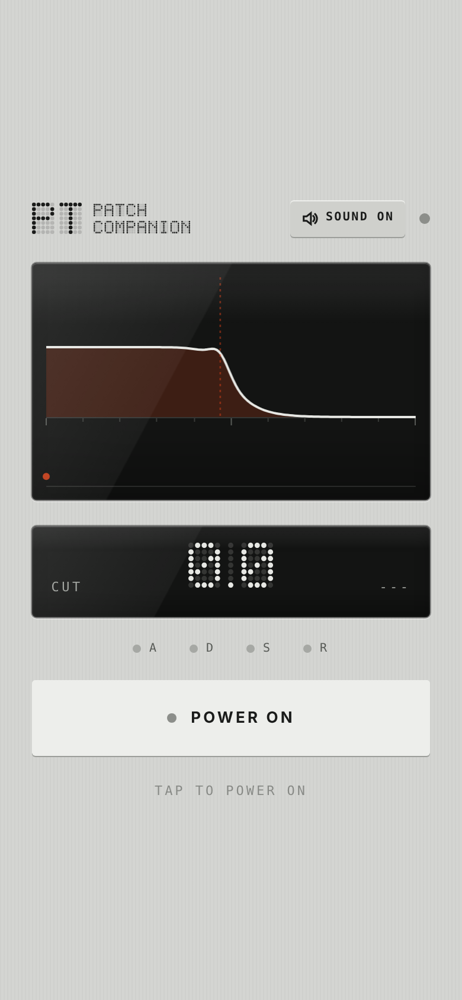 | 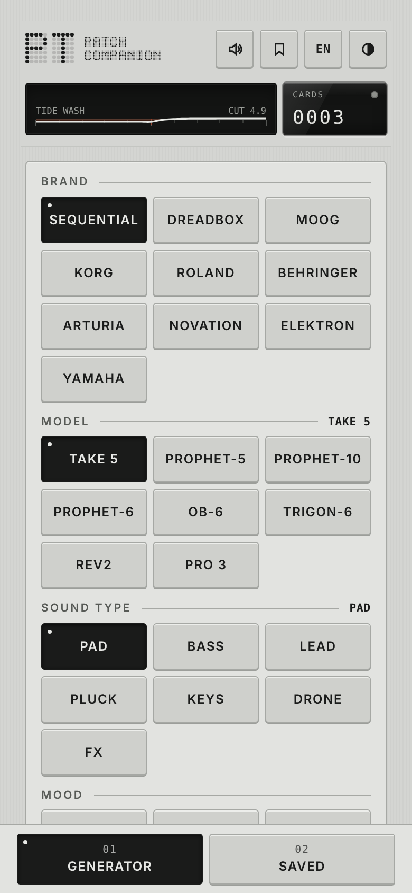 | 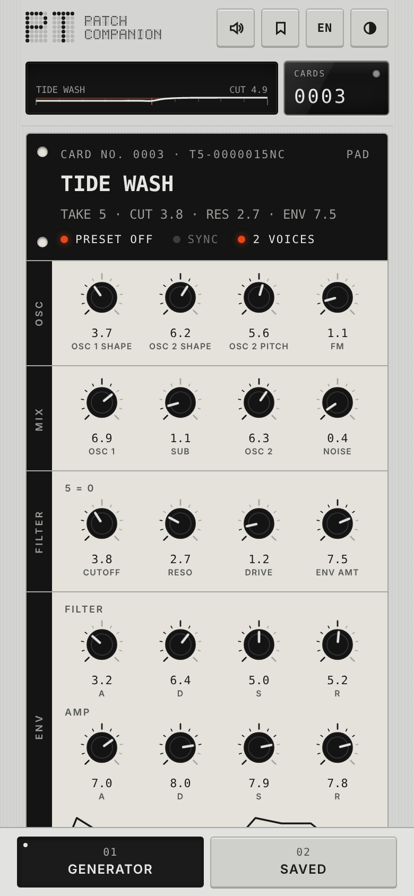 | 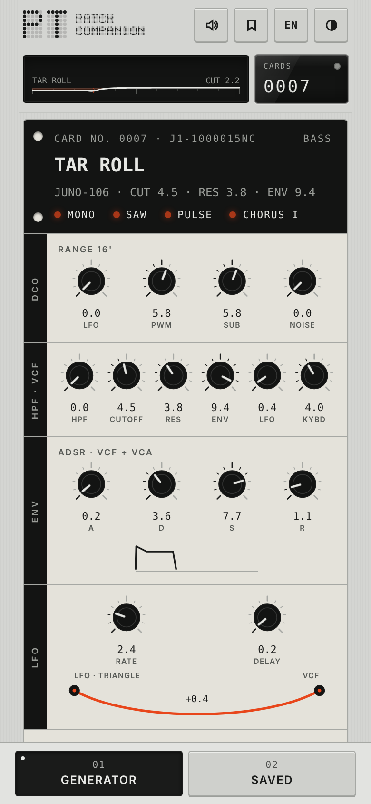 |

| Card: FM | Moods and locks | Dark skin |
|---|---|---|
| 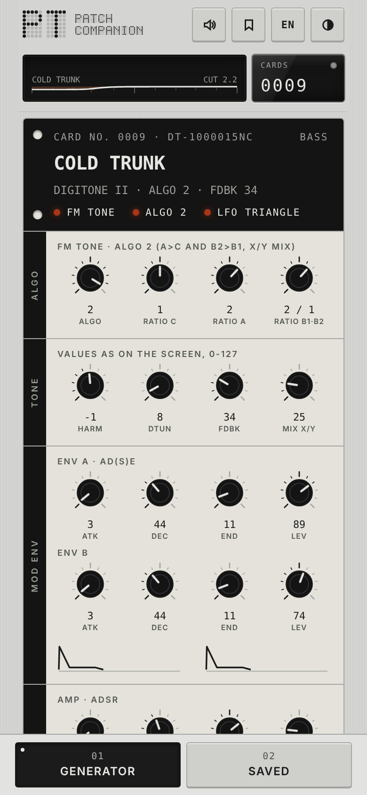 | 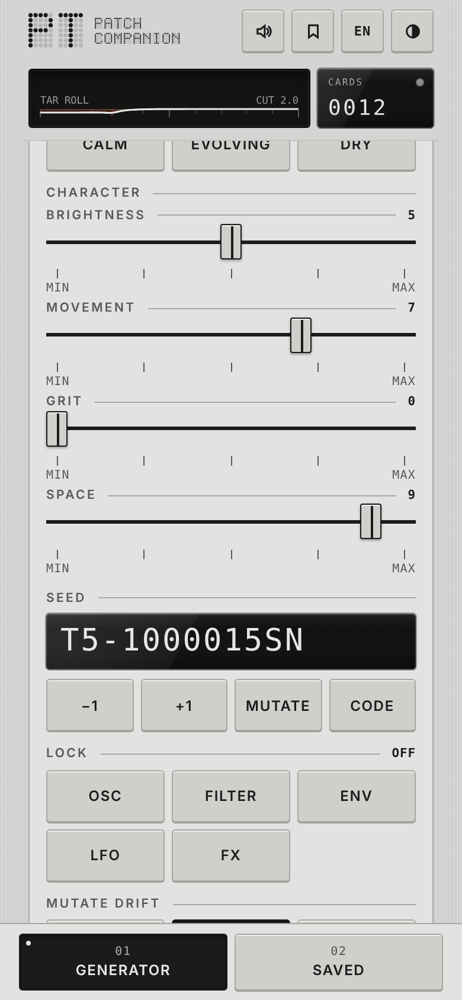 | 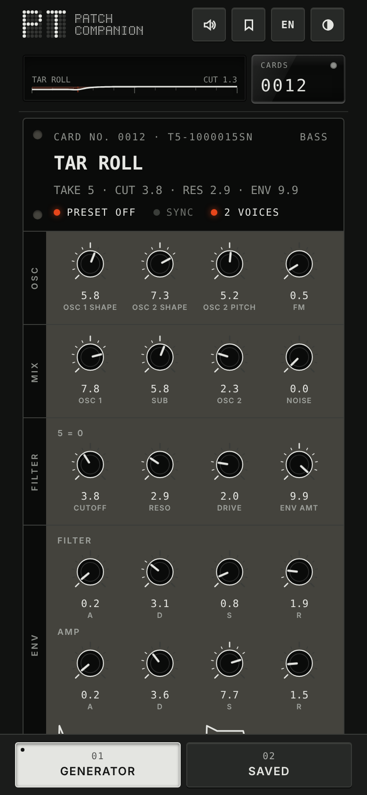 |

**Share as a picture and print on A4**

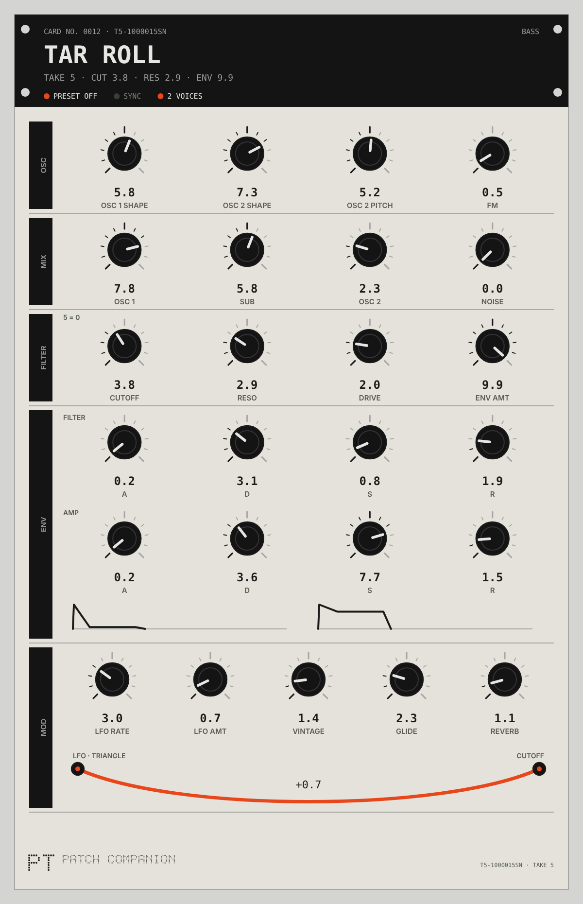

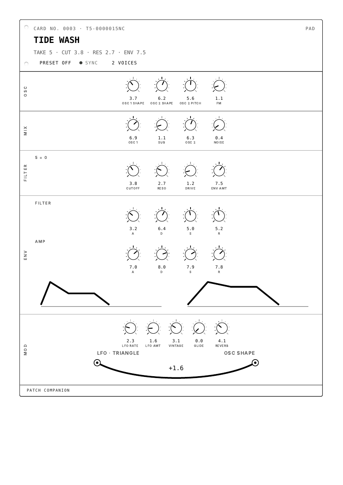

**Desktop and tablet**

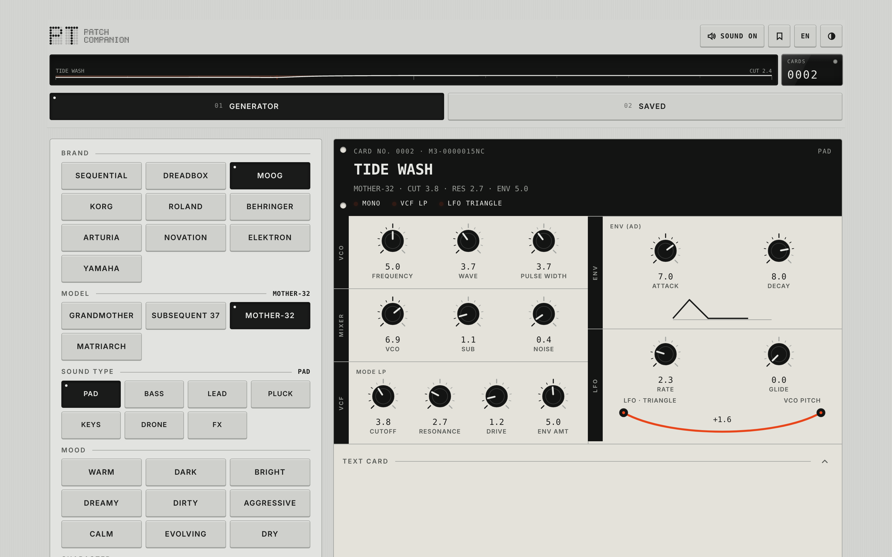

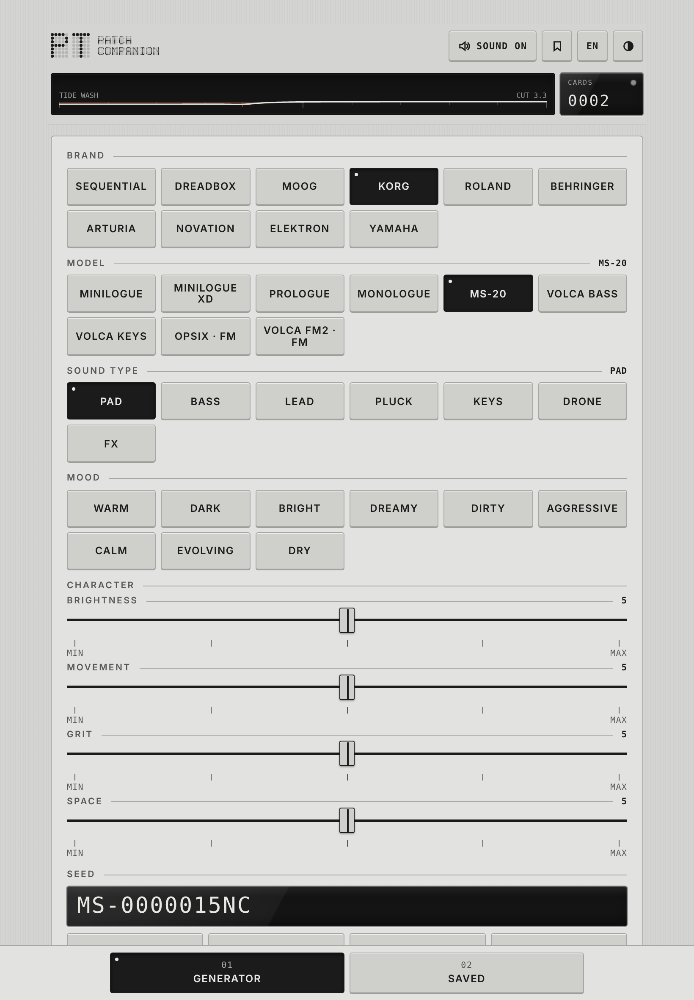

## The Companion family

- **[Producer Companion](https://github.com/SHOOGAZE/producer-companion)** ([live](https://shoogaze.github.io/producer-companion/)): the idea, the structure and the names of a track
- **[Sequential Companion](https://github.com/SHOOGAZE/sequential-companion)** ([live](https://shoogaze.github.io/sequential-companion/)): the first drum pattern
- **Patch Companion**: the sound to play it with

The three are linked from the footer, and the link carries genre, tempo and mood along.

## Run

Live build: https://shoogaze.github.io/patch-companion/

Open `index.html` in a browser. No build step. For GitHub Pages: Settings → Pages → deploy from branch `main`, root.

**Install on iPhone:** open the site in Safari → Share → Add to Home Screen. It then runs full-screen and offline. Keep `manifest.webmanifest`, `sw.js` and the `icons/` folder next to `index.html`.

## License

[MIT](LICENSE) © 2026 Kirill Kinderhart
